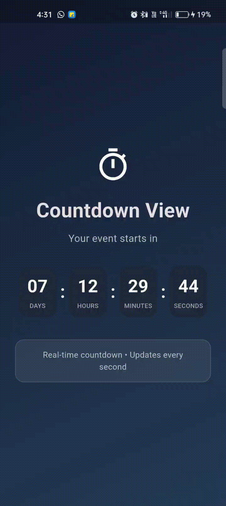

# Flutter Countdown View

A clean, customizable, and responsive countdown timer widget for Flutter applications. Display remaining **days, hours, minutes, and seconds** with customizable colors, sizes, typography, separators, labels, and completion callbacks.

Built with a responsive layout to prevent horizontal overflow across different screen sizes.


## Features

* ⏳ Real-time countdown updates every second
* 📅 Days, hours, minutes, and seconds display
* 🎨 Fully customizable colors
* 📐 Custom box width, height, and border radius
* 🔤 Custom number and label font sizes
* 💪 Custom number and label font weights
* 🏷️ Show or hide labels
* ➗ Show or hide separators
* 🎯 Show or hide individual time units
* 📱 Responsive layout for different screen sizes
* 🔄 Automatically restarts when the target date changes
* ✅ Completion callback with `onComplete`
* 🛡️ Safe timer lifecycle management
* 🧩 Lightweight and easy to integrate
* 🚀 No unnecessary dependencies

---

## Demo

The example application demonstrates a live countdown with customizable styling.

<p align="center">
  
</p>

> Add your recorded demo GIF at:
>
> `example/assets/countdown.gif`

---

## Installation

Add `flutter_countdown_view` to your `pubspec.yaml`:

```yaml
dependencies:
  flutter_countdown_view: ^1.0.0
```

Then run:

```bash
flutter pub get
```

Import the package:

```dart
import 'package:flutter_countdown_view/flutter_countdown_view.dart';
```

---

## Quick Start

The simplest implementation:

```dart
import 'package:flutter/material.dart';
import 'package:flutter_countdown_view/flutter_countdown_view.dart';

class CountdownExample extends StatelessWidget {
  const CountdownExample({super.key});

  @override
  Widget build(BuildContext context) {
    final targetDateTime = DateTime.now().add(
      const Duration(days: 7, hours: 12, minutes: 30),
    );

    return CountdownView(
      targetDateTime: targetDateTime,
    );
  }
}
```

---

## Custom Countdown

Customize the appearance using `CountdownConfig`:

```dart
CountdownView(
  targetDateTime: DateTime.now().add(
    const Duration(days: 5, hours: 8, minutes: 20),
  ),
  config: const CountdownConfig(
    backgroundColor: Color(0xFF202938),
    textColor: Colors.white,
    labelColor: Colors.white60,
    separatorColor: Colors.white,
    borderRadius: 16,
    boxWidth: 72,
    boxHeight: 82,
    numberFontSize: 28,
    labelFontSize: 10,
  ),
)
```

---

## Completion Callback

Use `onComplete` to execute code when the countdown reaches zero.

```dart
CountdownView(
  targetDateTime: DateTime.now().add(
    const Duration(minutes: 5),
  ),
  onComplete: () {
    debugPrint('Countdown completed');
  },
)
```

The callback is triggered once when the countdown reaches zero.

---

## CountdownConfig

`CountdownConfig` controls the complete visual appearance and displayed time units.

### Colors

| Property          | Type    | Default             |
| ----------------- | ------- | ------------------- |
| `backgroundColor` | `Color` | `Color(0xFF1E1E2C)` |
| `textColor`       | `Color` | `Colors.white`      |
| `labelColor`      | `Color` | `Color(0xFFB8B8C7)` |
| `separatorColor`  | `Color` | `Colors.white`      |

Example:

```dart
const CountdownConfig(
  backgroundColor: Color(0xFF151A24),
  textColor: Colors.white,
  labelColor: Colors.white70,
  separatorColor: Colors.blueAccent,
)
```

---

### Box Customization

| Property       | Type     | Default |
| -------------- | -------- | ------- |
| `borderRadius` | `double` | `12`    |
| `boxWidth`     | `double` | `70`    |
| `boxHeight`    | `double` | `80`    |

Example:

```dart
const CountdownConfig(
  borderRadius: 20,
  boxWidth: 75,
  boxHeight: 85,
)
```

The widget automatically adapts its box width according to the available screen space to help prevent horizontal overflow.

---

### Typography

| Property           | Type         | Default           |
| ------------------ | ------------ | ----------------- |
| `numberFontSize`   | `double`     | `28`              |
| `labelFontSize`    | `double`     | `11`              |
| `numberFontWeight` | `FontWeight` | `FontWeight.bold` |
| `labelFontWeight`  | `FontWeight` | `FontWeight.w500` |

Example:

```dart
const CountdownConfig(
  numberFontSize: 30,
  labelFontSize: 10,
  numberFontWeight: FontWeight.w700,
  labelFontWeight: FontWeight.w600,
)
```

---

## Show or Hide Time Units

You can independently control which units are displayed.

### Hide Days

```dart
const CountdownConfig(
  showDays: false,
)
```

### Show Only Hours, Minutes and Seconds

```dart
const CountdownConfig(
  showDays: false,
  showHours: true,
  showMinutes: true,
  showSeconds: true,
)
```

### Show Only Minutes and Seconds

```dart
const CountdownConfig(
  showDays: false,
  showHours: false,
  showMinutes: true,
  showSeconds: true,
)
```

### Available Properties

```dart
showDays
showHours
showMinutes
showSeconds
```

---

## Labels

Labels can be enabled or disabled.

### With Labels

```dart
const CountdownConfig(
  showLabels: true,
)
```

Displays:

```text
05    12    30    45
DAYS  HOURS MINUTES SECONDS
```

### Without Labels

```dart
const CountdownConfig(
  showLabels: false,
)
```

---

## Separators

Separators between countdown boxes can also be controlled.

### Show Separators

```dart
const CountdownConfig(
  showSeparators: true,
)
```

### Hide Separators

```dart
const CountdownConfig(
  showSeparators: false,
)
```

---

## Complete Configuration Example

```dart
CountdownView(
  targetDateTime: DateTime.now().add(
    const Duration(
      days: 10,
      hours: 8,
      minutes: 45,
      seconds: 30,
    ),
  ),
  config: const CountdownConfig(
    backgroundColor: Color(0xFF202938),
    textColor: Colors.white,
    labelColor: Color(0xFFB8B8C7),
    separatorColor: Colors.white,
    borderRadius: 16,
    boxWidth: 72,
    boxHeight: 82,
    numberFontSize: 28,
    labelFontSize: 10,
    numberFontWeight: FontWeight.bold,
    labelFontWeight: FontWeight.w500,
    showDays: true,
    showHours: true,
    showMinutes: true,
    showSeconds: true,
    showLabels: true,
    showSeparators: true,
  ),
  onComplete: () {
    debugPrint('Countdown completed');
  },
)
```

---

## API Reference

### CountdownView

```dart
CountdownView({
  Key? key,
  required DateTime targetDateTime,
  CountdownConfig config = const CountdownConfig(),
  VoidCallback? onComplete,
})
```

### Parameters

#### `targetDateTime`

```dart
final DateTime targetDateTime;
```

The date and time at which the countdown should reach zero.

This parameter is required.

Example:

```dart
targetDateTime: DateTime(2026, 12, 31, 23, 59, 59),
```

---

#### `config`

```dart
final CountdownConfig config;
```

Controls the appearance and visible units of the countdown.

Default:

```dart
const CountdownConfig()
```

---

#### `onComplete`

```dart
final VoidCallback? onComplete;
```

Optional callback executed once when the countdown reaches zero.

Example:

```dart
onComplete: () {
  debugPrint('Time is up!');
},
```

---

## CountdownConfig API

```dart
CountdownConfig({
  Color backgroundColor,
  Color textColor,
  Color labelColor,
  Color separatorColor,
  double borderRadius,
  double boxWidth,
  double boxHeight,
  double numberFontSize,
  double labelFontSize,
  FontWeight numberFontWeight,
  FontWeight labelFontWeight,
  bool showDays,
  bool showHours,
  bool showMinutes,
  bool showSeconds,
  bool showLabels,
  bool showSeparators,
})
```

---

## Responsive Design

`CountdownView` uses Flutter's available layout constraints to adapt the countdown boxes to the available width.

This makes the widget suitable for:

* Small Android phones
* Large Android phones
* Tablets
* Different device orientations
* Different parent container widths

For example:

```dart
Padding(
  padding: const EdgeInsets.symmetric(horizontal: 16),
  child: CountdownView(
    targetDateTime: DateTime.now().add(
      const Duration(days: 3),
    ),
  ),
)
```

The countdown automatically adjusts its box sizing based on the available width.

---

## Dynamic Target Date

The countdown can be updated by changing `targetDateTime`.

```dart
CountdownView(
  targetDateTime: selectedDateTime,
)
```

When the target date changes, the countdown timer automatically restarts using the new target.

---

## Expired Countdown

If the target date has already passed, the countdown displays:

```text
00    00    00    00
```

The timer does not continue running after completion.

---

## Lifecycle Safety

The package manages its internal timer lifecycle safely.

The timer:

* Starts when the widget initializes
* Updates every second
* Restarts when the target date changes
* Stops when the countdown completes
* Is cancelled when the widget is disposed

This prevents unnecessary timer activity after the widget is removed from the widget tree.

---

## Project Structure

```text
flutter_countdown_view/
│
├── lib/
│   ├── flutter_countdown_view.dart
│   │
│   └── src/
│       ├── models/
│       │   └── countdown_config.dart
│       │
│       ├── utils/
│       │   └── countdown_utils.dart
│       │
│       └── widgets/
│           └── countdown_view.dart
│
├── example/
│   ├── assets/
│   │   └── countdown.gif
│   │
│   ├── lib/
│   │   └── main.dart
│   │
│   └── test/
│       └── widget_test.dart
│
├── test/
│   └── flutter_countdown_view_test.dart
│
├── CHANGELOG.md
├── LICENSE
├── README.md
└── pubspec.yaml
```

---

## Example Application

The package includes an example application demonstrating:

* Live countdown updates
* Responsive countdown layout
* Custom styling
* Labels
* Separators
* Completion callback

Run the example:

```bash
cd example
flutter pub get
flutter run
```

---

## Testing

Run package tests from the package root:

```bash
flutter test
```

Run static analysis:

```bash
flutter analyze
```

Run the example application:

```bash
cd example
flutter run
```

---

## Recommended Development Checks

Before publishing or pushing changes, run:

```bash
flutter clean
flutter pub get
flutter analyze
flutter test
```

Then verify the example:

```bash
cd example
flutter pub get
flutter analyze
flutter test
flutter run
```

---

## Requirements

* Flutter 3.41.9 or compatible Flutter SDK
* Dart 3.11.5 or compatible Dart SDK
* Android
* iOS
* Web
* Windows
* macOS
* Linux

The package uses Flutter's standard framework APIs and does not require platform-specific configuration.

---

## Dependencies

The package is designed to remain lightweight and does not require additional third-party runtime packages.

Core functionality uses Flutter and Dart APIs.

---

## Why Flutter Countdown View?

A countdown component is commonly required for:

* Event applications
* Product launches
* Sales campaigns
* Offers and promotions
* Booking applications
* Live events
* Contest applications
* Upcoming feature announcements
* Subscription expiration
* Appointment reminders

`flutter_countdown_view` provides a reusable solution without requiring developers to build the timer, formatting, layout, and responsive behavior from scratch.

---

## Contributing

Contributions are welcome.

To contribute:

1. Fork the repository.
2. Create a feature branch.

```bash
git checkout -b feature/my-feature
```

3. Make your changes.
4. Run analysis and tests.

```bash
flutter analyze
flutter test
```

5. Commit your changes.

```bash
git commit -m "Add my feature"
```

6. Push your branch.

```bash
git push origin feature/my-feature
```

7. Open a Pull Request.

Please keep contributions focused, clean, and compatible with the existing package API.

---

## Issues and Feature Requests

If you find a bug or have an idea for improving the package, please open an issue on GitHub.

When reporting a bug, include:

* Flutter version
* Dart version
* Platform/device
* Package version
* Reproduction steps
* Relevant error logs
* Minimal reproducible example when possible

---

## License

This project is licensed under the MIT License.

```text
MIT License

Copyright (c) 2026 Excelsior Technologies

Permission is hereby granted, free of charge, to any person obtaining a copy
of this software and associated documentation files (the "Software"), to deal
in the Software without restriction, including without limitation the rights
to use, copy, modify, merge, publish, distribute, sublicense, and/or sell
copies of the Software, and to permit persons to whom the Software is
furnished to do so, subject to the following conditions:

The above copyright notice and this permission notice shall be included in all
copies or substantial portions of the Software.

THE SOFTWARE IS PROVIDED "AS IS", WITHOUT WARRANTY OF ANY KIND, EXPRESS OR
IMPLIED, INCLUDING BUT NOT LIMITED TO THE WARRANTIES OF MERCHANTABILITY,
FITNESS FOR A PARTICULAR PURPOSE AND NONINFRINGEMENT. IN NO EVENT SHALL THE
AUTHORS OR COPYRIGHT HOLDERS BE LIABLE FOR ANY CLAIM, DAMAGES OR OTHER
LIABILITY, WHETHER IN AN ACTION OF CONTRACT, TORT OR OTHERWISE, ARISING FROM,
OUT OF OR IN CONNECTION WITH THE SOFTWARE OR THE USE OR OTHER DEALINGS IN THE
SOFTWARE.
```

---

## Author

### Sufiyan Shaikh

Flutter Developer Intern
**Excelsior Technologies**

Focused on building clean, reusable, and production-ready Flutter packages and mobile applications.

---
## Repository

**Flutter Countdown View**

GitHub:

```text
https://github.com/sufiyanshaikh-1304/flutter_countdown_view

